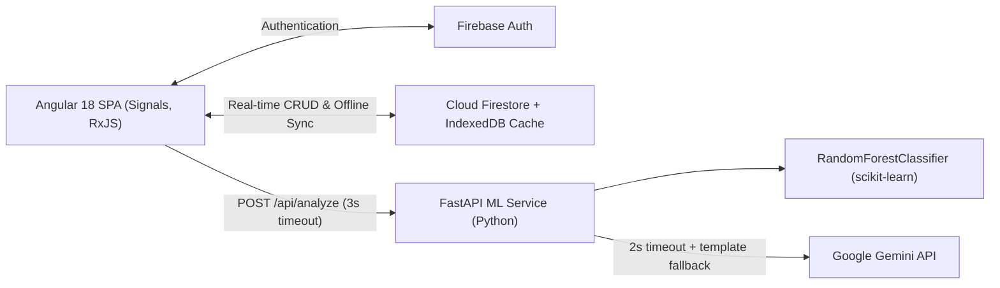

# HabitFlow

**English** | [Українська](README.uk.md)


**HabitFlow** is an AI-assisted habit tracking and adaptive scheduling web application. Instead of rigid reminders and streak penalties, HabitFlow analyzes actual behavioral history — check-in delays, weekend drop-offs, and consistency trends — to predict skip risk and suggest realistic schedule adjustments.

---

## Table of Contents

- [Key Features](#key-features)
- [Architecture & Tech Stack](#architecture--tech-stack)
- [Repository Structure](#repository-structure)
- [Getting Started](#getting-started)
- [Custom Firebase Setup](#custom-firebase-setup)
- [Environment Variables](#environment-variables)
- [ML Service REST API](#ml-service-rest-api)
- [Testing & Production Build](#testing--production-build)

---

## Key Features

### Daily Habit Tracking
- **Flexible Scheduling:** Daily (`Mon–Sun`) or custom weekday schedules (e.g., `Mon, Wed, Fri`), user-defined custom categories, habit archiving, and 1-click restoration without losing history.
- **1-Click Check-Ins & Yesterday Confirmation:** Instant daily completion tracking with automatic delay calculation (`delayMinutes`), plus a retroactive yesterday confirmation prompt to protect streaks from forgotten check-ins.
- **Fair Streak & Consistency Math:** Unscheduled weekdays and dates prior to `createdAt` never break `currentStreak` or penalize completion percentages.
- **Timezone-Aware & Dual Theme:** Reactive IANA timezone support across all views and light/dark *Editorial Minimalism* themes.

### Adaptive Schedule Intelligence (ML + Generative AI)
- **Skip-Risk Classification:** A `RandomForestClassifier` (`scikit-learn`) evaluates 5 behavioral features over a 30-day rolling window: 7-day miss rate, 14-day miss rate, weekend miss rate, mean check-in delay, and active streak.
- **Root-Cause Detection & Actionable Suggestions:**
  - `late_checkin` — systematic late completions; recommends shifting `reminderTime` by median actual delay rounded to 15-minute intervals.
  - `weekend_drop` — recurring Saturday/Sunday misses; recommends switching to a `Mon–Fri` (`5 days/week`) schedule.
  - `low_regularity` — overall consistency decline; recommends lightening weekly frequency.
- **Smart Guardrails:** Cold-start protection (`< 14 days` of history), explicit `aiConsent` enforcement, 7-day recommendation TTL, post-adaptation cooldown, and an automatic 7-day pause after two dismissals.
- **3-Tier Resilience:** Personalized advice is generated via `Google Gemini API` with a strict `2s` timeout; if unavailable or unconfigured, the backend falls back to deterministic templates; if the Python service is offline or exceeds `3s`, the Angular client seamlessly switches to in-browser heuristic scoring backed by Firestore `IndexedDB` offline persistence.

### Visual Analytics & Data Privacy
- **Interactive `7 / 14 / 30`-Day Statistics:** Period-over-period consistency sparkline, weekday completion bar chart, check-in time scatter plot (`06:00–23:00`), and expandable completion log with per-habit filtering.
- **Security & Account Control:** Owner-scoped Firestore security rules with payload schema validation, password reset via email, and re-authenticated cascading account deletion across all collections.

---

## Architecture & Tech Stack



| Layer | Technologies |
|-------|--------------|
| **Frontend** | Angular 18 (Standalone Components, Signals), TypeScript 5.5, RxJS 7.8, SCSS |
| **Auth & Database** | Firebase Authentication, Cloud Firestore (`persistentLocalCache`) |
| **ML Backend** | Python 3.11+, FastAPI, Uvicorn, Pydantic v2, `scikit-learn`, `pandas`, `numpy` |
| **Generative AI** | Google GenAI SDK (`google-genai`) with bounded latency fallback |
| **Testing** | `pytest`, `httpx` (metamorphic tests MR1–MR5 + API), Karma + Jasmine (`ChromeHeadless`) |

**Cloud Firestore Collections:** `users` (profile, timezone, consent, daily advice limit), `habits` (schedule config, streaks, `scheduleHistory`), `habit_logs` (check-in timestamps and `delayMinutes`), `recommendations` (ML predictions and lifecycle status).

---

## Repository Structure

```text
habitflow/
├── frontend/                        # Angular 18 single-page application
│   ├── src/
│   │   ├── app/
│   │   │   ├── core/                # Domain models, services, authGuard, timezone utilities
│   │   │   ├── shared/              # Reusable confirmation modal components
│   │   │   └── features/            # Pages: auth, dashboard, schedule-analysis, statistics, modals
│   │   ├── environments/            # Firebase config and ML service URL
│   │   └── styles.scss              # Design tokens and light/dark theme variables
│   └── package.json
├── ml-service/                      # FastAPI skip-risk prediction microservice
│   ├── app/
│   │   ├── controllers/             # GET /health and POST /api/analyze endpoints
│   │   ├── models/                  # RandomForestClassifier wrapper & schedule adaptation rules
│   │   ├── schemas/                 # Pydantic v2 request/response DTOs
│   │   ├── services/                # FeatureExtractor, HabitRiskPredictorService, AiExplanationService
│   │   ├── config.py                # Environment-driven settings
│   │   └── main.py                  # FastAPI app factory & CORS middleware
│   ├── tests/                       # API contract & metamorphic test suites (MR1–MR5)
│   ├── .env.example                 # Environment variable template
│   └── requirements.txt
└── firebase/
    └── firestore.rules              # Owner-only access & document field validation rules
```

---

## Getting Started

### Prerequisites
- **Node.js** `18.19+` or `20+` and `npm`
- **Python** `3.11+` (tested on `3.11–3.13`)
- *(Optional)* A [Google AI Studio (Gemini)](https://aistudio.google.com/) API key — without a key, the app runs out of the box using built-in deterministic advice templates.

### 1. Clone the Repository

```bash
git clone https://github.com/Tixon9I/habitflow.git
cd habitflow
```

### 2. Start the Python ML Service

Open a terminal in `ml-service`:

**Windows (PowerShell):**
```powershell
cd ml-service
python -m venv .venv
.\.venv\Scripts\Activate.ps1
pip install -r requirements.txt
Copy-Item .env.example .env
python -m uvicorn app.main:app --reload --port 8000
```

**macOS / Linux:**
```bash
cd ml-service
python3 -m venv .venv
source .venv/bin/activate
pip install -r requirements.txt
cp .env.example .env
python -m uvicorn app.main:app --reload --port 8000
```

- On first startup, the service automatically trains the default `RandomForestClassifier` model and caches it at `app/models/habit_risk_rf.joblib`.
- Interactive Swagger UI is available at `http://127.0.0.1:8000/docs` and health metrics at `http://127.0.0.1:8000/health`.

### 3. Start the Angular Frontend

Open a second terminal in `frontend`:

```bash
cd frontend
npm install
npx ng serve
```

Open `http://localhost:4200` in your browser.

> **1-Click Demo Dataset:** After signing up, click **«Тестові дані (30 дн.)»** in the top navigation bar to populate 7 diverse habit archetypes (stable anchor, systematic late check-ins, weekend drop-off, declining regularity, `Mon/Wed/Fri` custom schedule, 5-day cold-start habit, and an archived habit) and immediately preview ML schedule recommendations.
>
> **Offline / Standalone Mode:** The frontend works even if `ml-service` is not running — when `127.0.0.1:8000` is unreachable, HabitFlow automatically falls back to client-side heuristic risk scoring.

---

## Custom Firebase Setup

`frontend/src/environments/environment.ts` ships with a preconfigured demo Firebase project. To connect your own Firebase backend:

1. Create a project in the [Firebase Console](https://console.firebase.google.com/).
2. Enable **Email/Password** under **Authentication → Sign-in method**.
3. Create a **Cloud Firestore** database and publish the rules from [`firebase/firestore.rules`](firebase/firestore.rules).
4. Replace the `firebase` config object in `frontend/src/environments/environment.ts` and `frontend/src/environments/environment.prod.ts`.

---

## Environment Variables

Configured in `ml-service/.env` (copied from `ml-service/.env.example`):

| Variable | Default | Description |
|----------|---------|-------------|
| `GEMINI_API_KEY` | *(empty)* | Google Gemini API key. Leave empty to use deterministic template advice |
| `GEMINI_MODEL` | `gemini-3.5-flash-lite` | Gemini model identifier used for generating explanations |
| `GEMINI_TIMEOUT_SECONDS` | `2.0` | Timeout in seconds before falling back to template advice |
| `CORS_ORIGINS` | `http://localhost:4200,http://127.0.0.1:4200` | Comma-separated list of allowed frontend origins |
| `MODEL_ARTIFACT_PATH` | `app/models/habit_risk_rf.joblib` | Path where the trained Random Forest bundle is persisted |

---

## ML Service REST API

| Method | Endpoint | Description |
|--------|----------|-------------|
| `GET` | `/health` | Service readiness, model status, Gemini configuration flag, and evaluation metrics (`f1Score`, `precision`, feature importances) |
| `POST` | `/api/analyze` | Accepts active user habits and check-in logs, extracts 30-day behavioral features, and returns ranked schedule recommendations plus `coldStartHabitIds` |

---

## Testing & Production Build

### Python ML Service Tests (API + Metamorphic Relations MR1–MR5)
Verifies API contracts, inference latency, cold-start filtering, miss-rate and delay monotonicity, weekend drop sensitivity, log permutation invariance, and LLM timeout fallback:

```bash
cd ml-service
python -m pytest tests/ -v
```

### Frontend Unit Tests & Production Build

```bash
cd frontend

# Run Karma + Jasmine unit tests in headless Chrome
npx ng test --watch=false --browsers=ChromeHeadless

# Verify optimized production bundle
npx ng build --configuration=production
```
