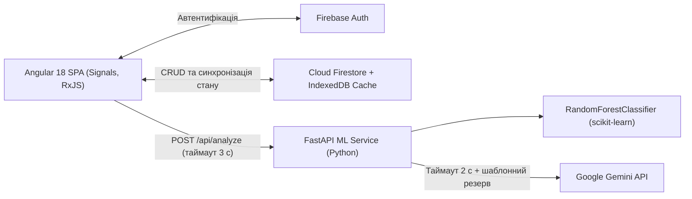

# HabitFlow

[English](README.md) | **Українська**


**HabitFlow** — вебзастосунок для формування звичок та інтелектуальної адаптації розкладу на основі поведінкової історії користувача. Замість жорстких сповіщень і «покарання» за зірвані серії система аналізує фактичний час відміток, виявляє систематичні відхилення (запізнення, спад у вихідні дні, зниження регулярності) та пропонує реалістичну корекцію графіка.

---

## Зміст

- [Ключові можливості](#ключові-можливості)
- [Архітектура та стек технологій](#архітектура-та-стек-технологій)
- [Структура репозиторію](#структура-репозиторію)
- [Швидкий старт](#швидкий-старт)
- [Налаштування власного Firebase](#налаштування-власного-firebase)
- [Конфігурація змінних середовища](#конфігурація-змінних-середовища)
- [REST API аналітичного сервісу](#rest-api-аналітичного-сервісу)
- [Тестування та збірка](#тестування-та-збірка)

---

## Ключові можливості

### Управління звичками та щоденна робота
- **Гнучкий графік:** щоденне виконання (`Пн–Нд`) або вибіркові дні тижня (наприклад, `Пн, Ср, Пт`), власні користувацькі категорії, архівація та відновлення звичок без втрати історії.
- **Відмітка в 1 клік та ретроспективне підтвердження:** миттєва фіксація виконання за поточний день із розрахунком фактичної затримки (`delayMinutes`) і блок підтвердження за вчорашній день для захисту серії від випадково забутих відміток.
- **Чесний розрахунок серій (`currentStreak` / `bestStreak`):** незаплановані дні тижня та дні до створення звички не обривають серію і не занижують статистику.
- **Підтримка часових поясів і тем оформлення:** реактивне перерахування дат та часу відповідно до обраного часового поясу IANA у профілі, перемикання світлої та темної тем (*Editorial Minimalism*).

### Розумний аналіз розкладу (ML + Generative AI)
- **Оцінювання ризику пропуску:** модель `RandomForestClassifier` (`scikit-learn`) аналізує 5 поведінкових ознак на ковзному вікні 30 діб: частку пропусків за 7 і 14 діб, просідання у вихідні, середню затримку відмітки та поточну серію.
- **Визначення головного фактора ризику:**
  - `late_checkin` — систематичне запізнення відміток (пропонується зсув нагадування за медіаною фактичного часу з кроком 15 хв);
  - `weekend_drop` — регулярні пропуски у суботу та неділю (пропонується перехід на графік `Пн–Пт`);
  - `low_regularity` — загальне зниження регулярності (пропонується полегшення тижневого навантаження).
- **Персоналізовані пояснення та захист від спаму:** генерація лаконічних порад українською мовою через `Google Gemini API` (лише за наявності згоди `aiConsent`), захист нових звичок на етапі «холодного старту» (`< 14 діб`), 7-денний термін актуальності порад (TTL) та автоматична пауза на 7 діб після двох відхилень.
- **Трирівнева відмовостійкість:** якщо ключ Gemini не налаштовано або вичерпано ліміт — спрацьовує миттєвий шаблонний генератор на сервері; якщо ж Python-сервіс вимкнено або час відповіді перевищує `3 с` — клієнт безшовно переходить на локальний евристичний розрахунок у браузері та офлайн-кеш `IndexedDB`.

### Аналітика та приватність
- **Інтерактивна статистика за `7 / 14 / 30` діб:** спарклайн динаміки з порівнянням до попереднього періоду, стовпчикова діаграма за днями тижня, точковий графік фактичного часу відміток (`06:00–23:00`) та детальний журнал виконання з фільтрацією за окремою звичкою.
- **Безпека та контроль даних:** правила безпеки Firestore з перевіркою власника документа й валідацією полів, скидання пароля електронною поштою та повне каскадне видалення облікового запису з усіма колекціями після повторної автентифікації.

---

## Архітектура та стек технологій



| Рівень | Технології |
|--------|------------|
| **Клієнтська частина** | Angular 18 (Standalone Components, Signals), TypeScript 5.5, RxJS 7.8, SCSS |
| **Автентифікація та БД** | Firebase Authentication, Cloud Firestore (`persistentLocalCache`) |
| **Сервіс аналітики та ML** | Python 3.11+, FastAPI, Uvicorn, Pydantic v2, `scikit-learn`, `pandas`, `numpy` |
| **Генеративний ШІ** | Google GenAI SDK (`google-genai`) з обмеженням часу очікування |
| **Тестування** | `pytest`, `httpx` (метаморфні тести MR1–MR5 + API), Karma + Jasmine (`ChromeHeadless`) |

**Колекції Cloud Firestore:** `users` (профіль та налаштування), `habits` (параметри звичок і `scheduleHistory`), `habit_logs` (історія відміток із затримками), `recommendations` (результати ML-аналізу та статуси прийняття/відхилення).

---

## Структура репозиторію

```text
habitflow/
├── frontend/                        # Клієнтський застосунок Angular 18
│   ├── src/
│   │   ├── app/
│   │   │   ├── core/                # Моделі даних, сервіси, authGuard, утиліти часу
│   │   │   ├── shared/              # Спільні модальні компоненти підтвердження
│   │   │   └── features/            # Сторінки: auth, dashboard, schedule-analysis, statistics, модалки
│   │   ├── environments/            # Конфігурація Firebase та URL ML-сервісу
│   │   └── styles.scss              # Дизайн-система та змінні світлої/темної тем
│   └── package.json
├── ml-service/                      # Мікросервіс прогнозування ризиків (FastAPI)
│   ├── app/
│   │   ├── controllers/             # Маршрути GET /health та POST /api/analyze
│   │   ├── models/                  # Обгортка RandomForestClassifier та логіка адаптації розкладу
│   │   ├── schemas/                 # DTO-схеми Pydantic v2
│   │   ├── services/                # FeatureExtractor, HabitRiskPredictorService, AiExplanationService
│   │   ├── config.py                # Налаштування сервісу через змінні середовища
│   │   └── main.py                  # Точка входу FastAPI та CORS
│   ├── tests/                       # Автоматизовані API та метаморфні тести (MR1–MR5)
│   ├── .env.example                 # Шаблон змінних середовища
│   └── requirements.txt
└── firebase/
    └── firestore.rules              # Правила розмежування доступу та валідації документів
```

---

## Швидкий старт

### Передумови
- **Node.js** `18.19+` або `20+` та `npm`
- **Python** `3.11+` (протестовано на `3.11–3.13`)
- *(Опційно)* API-ключ [Google AI Studio (Gemini)](https://aistudio.google.com/) — без нього застосунок повноцінно працює на детермінованих українських шаблонах порад.

### 1. Клонування репозиторію

```bash
git clone https://github.com/Tixon9I/habitflow.git
cd habitflow
```

### 2. Запуск Python ML-сервісу (бекенд аналітики)

Відкрийте перший термінал у папці `ml-service`:

**Windows (PowerShell):**
```powershell
cd ml-service
python -m venv .venv
.\.venv\Scripts\Activate.ps1
pip install -r requirements.txt
Copy-Item .env.example .env
python -m uvicorn app.main:app --reload --port 8000
```

**macOS / Linux:**
```bash
cd ml-service
python3 -m venv .venv
source .venv/bin/activate
pip install -r requirements.txt
cp .env.example .env
python -m uvicorn app.main:app --reload --port 8000
```

- Під час першого запуску сервіс автоматично навчить базову модель `RandomForestClassifier` і збереже артефакт у `app/models/habit_risk_rf.joblib`.
- Перевірити стан сервісу та інтерактивну документацію OpenAPI можна за адресою: `http://127.0.0.1:8000/docs` або `http://127.0.0.1:8000/health`.

### 3. Запуск Angular-клієнта (фронтенд)

Відкрийте другий термінал у папці `frontend`:

```bash
cd frontend
npm install
npx ng serve
```

Відкрийте у браузері `http://localhost:4200`.

> **Швидке ознайомлення з функціоналом:** після реєстрації натисніть кнопку **«Тестові дані (30 дн.)»** у верхній навігаційній панелі — застосунок автоматично створить набір із 7 різнопланових звичок (стабільна, із систематичними запізненнями, спадом на вихідних, зниженням регулярності, вибірковим графіком `Пн/Ср/Пт`, новою звичкою «холодного старту» та архівною) і одразу сформує рекомендації на вкладці **«Аналіз розкладу»**.
>
> Застосунок залишається повністю працездатним навіть без запущеного `ml-service`: за відсутності зв’язку з `127.0.0.1:8000` вмикається локальний резервний режим прогнозування в браузері.

---

## Налаштування власного Firebase

За замовчуванням у `frontend/src/environments/environment.ts` підключено демонстраційну конфігурацію Firebase. Якщо ви бажаєте розгорнути власну базу даних:

1. Створіть новий проєкт у [Firebase Console](https://console.firebase.google.com/).
2. У розділі **Authentication → Sign-in method** увімкніть провайдер **Email/Password**.
3. Створіть базу даних **Cloud Firestore** та опублікуйте правила безпеки з файлу [`firebase/firestore.rules`](firebase/firestore.rules).
4. Скопіюйте ключі вебзастосунку Firebase у файли `frontend/src/environments/environment.ts` та `frontend/src/environments/environment.prod.ts`.

---

## Конфігурація змінних середовища

Файл `ml-service/.env` (створюється з `ml-service/.env.example`):

| Змінна | Значення за замовчуванням | Опис |
|--------|---------------------------|------|
| `GEMINI_API_KEY` | *(порожньо)* | Ключ Google Gemini API. Якщо порожній — використовується вбудований шаблонний генератор порад |
| `GEMINI_MODEL` | `gemini-3.5-flash-lite` | Назва моделі Gemini для генерації тексту пояснень |
| `GEMINI_TIMEOUT_SECONDS` | `2.0` | Максимальний час очікування відповіді від LLM перед переходом на шаблон |
| `CORS_ORIGINS` | `http://localhost:4200,http://127.0.0.1:4200` | Перелік дозволених клієнтських джерел через кому |
| `MODEL_ARTIFACT_PATH` | `app/models/habit_risk_rf.joblib` | Шлях до збереженого файлу навченої моделі |

---

## REST API аналітичного сервісу

| Метод | Маршрут | Призначення |
|-------|---------|-------------|
| `GET` | `/health` | Перевірка готовності сервісу, завантаження моделі, наявності ключа Gemini та метрик якості (`f1Score`, `precision`, ваги ознак) |
| `POST` | `/api/analyze` | Приймає активні звички та журнал відміток користувача, виділяє ознаки й повертає відсортовані рекомендації та перелік `coldStartHabitIds` |

---

## Тестування та збірка

### Тести ML-сервісу (API + метаморфне тестування MR1–MR5)
Перевіряють контракт API, час відгуку, обробку «холодного старту», монотонність ризику при зростанні пропусків і затримок, чутливість до вихідних днів, інваріантність до перестановки логів та перехід на шаблон при таймауті LLM:

```bash
cd ml-service
python -m pytest tests/ -v
```

### Модульні тести та production-збірка фронтенду

```bash
cd frontend

# Запуск unit-тестів сервісів статистики та аналізу ризиків
npx ng test --watch=false --browsers=ChromeHeadless

# Перевірка повної оптимізованої збірки
npx ng build --configuration=production
```
